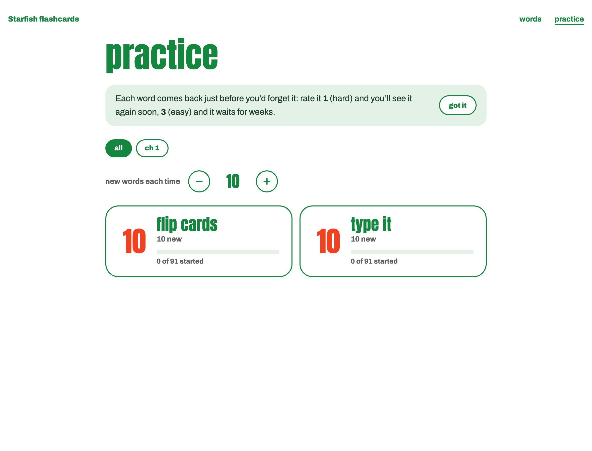
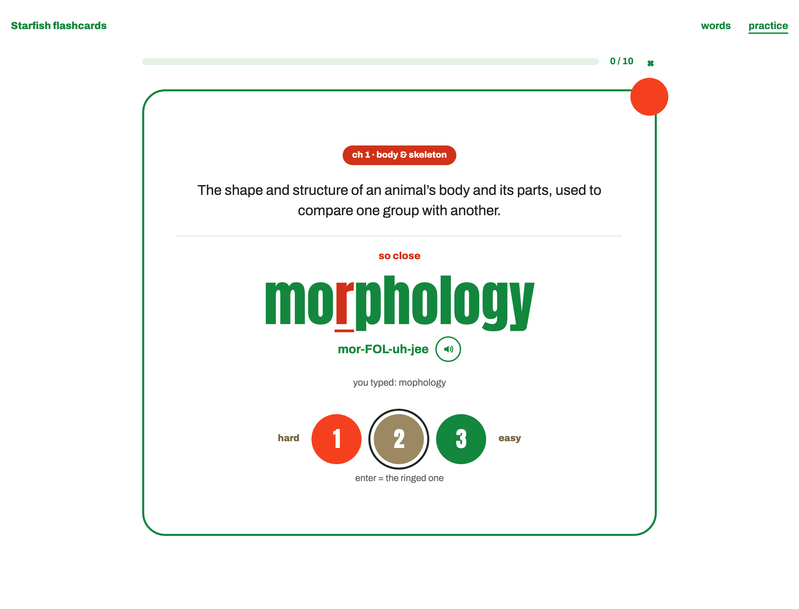

# Flashcard Maker

A Claude Code skill that turns chapters of a textbook PDF into a study page: a word list and flashcards with spaced repetition, spelling practice and pronunciation guides.

You give Claude a PDF and say which chapters. It reads them, picks the vocabulary you need to follow the book, writes a plain-English meaning for each word based on how the book uses it, looks up how to say it, and builds one page you can use on a computer or a phone.



## The study page

The page is a single HTML file with two tabs, Words and Practice.

**Words.** Every word, searchable and filtered by chapter, with:
- a pronunciation guide, such as *autotomy* → aw-TOT-uh-mee
- a meaning that follows the book, pitched at how much you already know about the subject (Claude asks)
- Greek or Latin roots where they help you remember it

**Practice.** The same words, two ways:
- **Flip cards:** see the word, recall the meaning, then check.
- **Type it:** read the meaning and spell the word. The page says the word aloud when you submit and underlines any letters you got wrong.

After each card you rate it 1 (hard), 2 (okay) or 3 (easy). Words you find hard come back later in the session and again the next day; words you know wait longer, up to 90 days. You choose how many new words each session brings (5, 10, 20, 30 or all).

If the skill misses a word, add it on the Words tab, or ask Claude to add it. You can also hide words you don’t want to practise. Words you add on the page live in that browser; the Words tab’s “copy my added words” button gives you a list to paste to Claude, which adds them to the page for good.



## Example cards

From *Starfish: Biology and Ecology of the Asteroidea* (ed. John M. Lawrence), chapters 1–4:

| Word | Say it | Meaning |
|---|---|---|
| ossicles | OS-ih-kulz | The many small hard plates, made of a chalky mineral, that form a starfish’s skeleton and are joined by muscle and tissue. |
| ambulacral | am-byoo-LAY-krul | Describes the paired plates and channel running down the underside of each arm, where the tube feet come out. |
| tube feet | toob FEET | Small, soft, water-filled limbs along the underside groove of each arm, used for gripping and for pulling shellfish open. |
| madreporite | mad-ruh-POR-ite | The sieve-like plate on the top surface of a starfish; its position and the timing of its formation differ between groups. |
| pedicellariae | ped-ih-suh-LAIR-ee-ee | Tiny pincer-like organs on the body surface, used to remove parasites, deter predators and catch prey. |
| phylogeny | fy-LOJ-uh-nee | The evolutionary family tree of a group. It shows which kinds descend from, or are related to, which. |
| brachiolaria | brak-ee-oh-LAIR-ee-uh | A larval stage with three sticky arms at the front used to attach before settling; sand stars lack it. |
| autotomy | aw-TOT-uh-mee | Deliberately dropping a body part, such as an arm, usually at a set breaking point, to escape a predator or damage. |
| Asterias rubens | as-TEER-ee-us ROO-benz | A common northern European starfish whose arm has been studied for its mechanics and for how it breaks off and regrows. |
| spawning | SPAW-ning | Releasing eggs and sperm into the water, usually timed to a particular season or day so that the sex cells can meet. |

## Install

You need [Claude Code](https://claude.com/claude-code) and Python 3. In a terminal:

```
claude plugin marketplace add hclovecraft00/flashcard-maker
claude plugin install flashcard-maker@flashcard-maker
```

The first time it runs, Claude installs two small Python libraries, `pypdf` and `wordfreq`, into `~/.cache/flashcard-maker/lib`. This needs an internet connection, and Claude Code asks your permission before running it.

## Use

Open Claude Code in the folder with your PDF and ask, for example:

> make flashcards for chapters 1–3 of cell-biology.pdf

Claude asks which chapters, how much you already know about the subject, and whether you want British or American spelling. It then builds the page in a new folder next to the PDF and opens it. You can also start it directly with `/flashcard-maker:flashcard-maker`.

Later you can ask it to add a chapter, add or remove a word, or paste in the list from the page’s “copy my added words” button. Rebuilding the page keeps the practice progress saved in your browser.

## How it picks the words

1. It counts every word in each chapter that is rare in everyday English, and every repeated two-word phrase.
2. One sub-agent per chapter reads the chapter and keeps a term when the chapter uses it 3 or more times, explains it, or relies on it. Names (genus, species, groups) stay when used 4 or more times or when the book features them. Everyday words, people’s names and one-off examples are left out.
3. Each word belongs to the first chapter that uses it, and each chapter’s words are ordered by how often the chapter uses them, so the most important ones come first.

Meanings follow the book’s own definitions where it gives them. Pronunciations come from [Wiktionary](https://en.wiktionary.org) where it has an entry; the rest are written from standard pronunciation rules and marked “no dictionary entry” on the page.

## Privacy

The page never contains the book’s text, only the words, their meanings and guides. To look up pronunciations, only the words themselves are sent to Wiktionary. Your progress stays in your browser.

## Limits

- Progress is saved per device and doesn’t sync between them.
- Scanned PDFs without selectable text can’t be read.
- English-language books only.
- No pictures from the book.
